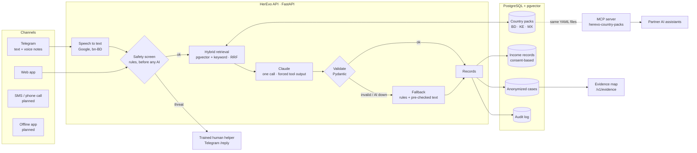

# HerEvo architecture

## Why it is built this way

- **Fixed pipeline, not an agent.** Users are vulnerable; every step must be predictable and auditable.
  The order never changes and safety always runs first.
- **Country packs as data.** Laws, contacts and advice change; local partners update a YAML file and
  redeploy, no retraining. A new country is a new pack.
- **Hybrid retrieval.** Keyword search catches the exact local words women use; vectors catch meaning.
  Bangla gets light suffix stripping and prefix matching so "ধানের" (of rice) finds "ধান" (rice).
- **One structured Claude call.** Routing, safety double-check, grounded answer, English translation and
  sale extraction in one forced tool call: cheaper, faster, always machine-checkable.
- **Graceful degradation.** No key, a network error or invalid output never breaks a conversation:
  the system falls back to rules and pre-checked text.
- **Privacy by design.** Salted user hashes, no phone numbers, anonymized evidence with small cells
  hidden, message text purged after 30 days, `/delete` for the right to be forgotten.
